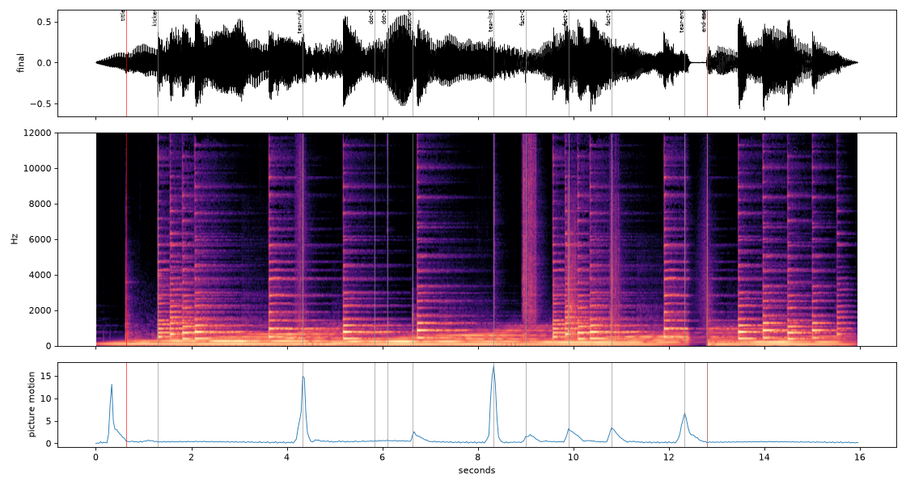

# Motion-Doc Studio 🎬🔊

**نظام متكامل لصناعة أفلام الموشن جرافيك الوثائقية، مع طبقة صوت احترافية مقاسة، ويعمل مع أي وكيل ذكاء اصطناعي.**
**A complete, agent-agnostic studio for documentary motion-graphics films, now with a measured SOUND LAYER.**

`Claude Code plugin` · `Codex plugin` · `Gemini CLI extension` · `Agent Skills (npx skills: 70+ agents)` · `MIT` · `v2.0.0`

<p align="center"></p>

▶️ Full example film («خط الثلث», 3:56): [`examples/thuluth/thuluth_final_720p.mp4`](examples/thuluth/thuluth_final_720p.mp4) ·
[1080p](https://github.com/zoih6/thuluth-motion-film/releases/tag/v3.1) · 🔊 Sound-layer demo (16 s, QA 0 FAIL):
[`examples/demo/demo_16s.mp4`](examples/demo/demo_16s.mp4)

---

## ⚡ التثبيت برسالة واحدة · One-message install

انسخ هذه الرسالة وأرسلها إلى **أي وكيل** (Claude Code، Codex، Gemini CLI، Cursor، Copilot، OpenCode، Windsurf…)، وسيثبّت كل شيء وحده:
Copy this message and send it to **any agent**. It installs the skills, the plugin, the dependencies, and checks the result:

```text
ثبّت لي Motion-Doc Studio باتباع التعليمات في هذا الرابط حرفيًا، ثم أخبرني بالنتيجة:
https://raw.githubusercontent.com/zoih6/motion-doc-studio/main/INSTALL.md
```
```text
Install Motion-Doc Studio by following https://raw.githubusercontent.com/zoih6/motion-doc-studio/main/INSTALL.md step by step, then report back.
```

<details><summary><b>Manual methods (per agent)</b></summary>

| Agent | Command |
|---|---|
| **Any (bash)** | `curl -fsSL https://raw.githubusercontent.com/zoih6/motion-doc-studio/main/install.sh \| bash` |
| **Claude Code** | `/plugin marketplace add zoih6/motion-doc-studio` → `/plugin install motion-doc-studio@motion-doc-studio` |
| **70+ agents (skills CLI)** | `npx skills add zoih6/motion-doc-studio` (`-g` global, `-a cursor` one agent, `--skill motion-sound-layer` one skill) |
| **Codex CLI** | `codex plugin marketplace add zoih6/motion-doc-studio`, or the installer (→ `~/.agents/skills`) |
| **Gemini CLI** | `gemini extensions install https://github.com/zoih6/motion-doc-studio` |
| **Inside this repo** | `AGENTS.md` (all agents), `CLAUDE.md`, `GEMINI.md`, `.cursor/rules/`, `.github/copilot-instructions.md` |

Installer options: `MDS_KIT=1` (build the sound library now) · `MDS_PROJECT=$PWD` · `MDS_AGENTS="claude cursor"` ·
`MDS_HOME=…` · `MDS_UNINSTALL=1`. Dependencies: git, Node ≥18, Python ≥3.10, ffmpeg, uv. The installer sets them up.
</details>

## What you get: two skills

| Skill | Use it for |
|---|---|
| [`motion-doc-studio`](skills/motion-doc-studio/SKILL.md) | VOX-style documentary / explainer / reel from a voice-over: brief → word timings → treatment → style bible → real + AI assets → code-driven canvas engine → critique loops → chunked render → GitHub release. Arabic/RTL-first. |
| [`motion-sound-layer`](skills/motion-sound-layer/SKILL.md) | Sound for any motion video, run **verbatim** from the SOUND LAYER prompt ([`PROMPT.md`](skills/motion-sound-layer/PROMPT.md)): real CC0 recordings, cues computed from the picture's own springs, peak-aligned −14 LUFS mix, `qa.py` decides, a human ear checks 5 timecodes. |

---

## 🔊 Sound Layer (v2.0)

> *"You can't hear. Use real recordings, place them from the timeline, look at every sound, and let the QA decide.
> A human does the final ear check."*

The picture is all springs and easings, so the sound cues are **computed from the same math**, never typed:

```js
// engine/scenes/demo.js: same t0 + spring as the draw() call
cue.hero('title', when.spring(.25, 'card'));                          // thump+tap · stop_before · build
cue.move('tear',  when.ease(4, 4 + TEAR), { sound: 'paper/fs-140463-packaging-paper-rub-sliding-1' });
cue.appear('dot', when.spring(5.8, 'snap'), { sound: 'pop', pitch: 2 });
```
`when.*` measures frames exactly like `qa.py` measures the video (frame-to-frame change: peak = `move`,
settle = `land`). `tools/export_cues.mjs` writes `audio/cues.json` in the `mix.py --schema` format. After that
it's the prompt, word for word: `sfx.py kit` (1,139 CC0 sounds / 19 types) → `browse` and **look** →
`mix.py` → mux → `qa.py` → fix ≤ 2 rounds → `LISTEN.md`.

**Demo, measured:** 13 cues · 42 pass · 3 warn · **0 FAIL** · −14.01 LUFS · TP −3.18 dBTP · offset 0 samples. Both release
encodes re-checked → 0 FAIL. The QA rounds, what changed, and what `qa.png` shows at each hero are in
[`examples/demo/sound/`](examples/demo/sound/README.md). The engine is
[Bodila51/opus-sound-layer](https://github.com/Bodila51/opus-sound-layer) (MIT), vendored **unmodified** at a pinned
commit with checksums ([`vendor/README.md`](vendor/README.md)).

<p align="center"></p>

---

## بالعربية

### ما هذا؟
خبرة إنتاج فيلم كامل، من التعليق الصوتي إلى الفيديو النهائي على GitHub، محوّلة إلى نظام (skill + plugin). يقرؤه أي وكيل
ذكاء اصطناعي فيعرف فورًا القواعد والمنهجية والأدوات والكود الجاهز، دون أن تحتاج إلى توجيهه في كل خطوة.

### الجديد في v2.0: طبقة الصوت
- **صوت حقيقي لا مُركَّب:** مكتبة من 1,139 تسجيلًا بترخيص CC0 (ورق، خشب، نقرات، ضربات، whoosh…). يُمنع توليد الضربات والنقرات صناعيًا.
- **التوقيت يُحسب من الحركة نفسها:** كل صوت مربوط بالنابض أو المنحنى الذي يحرّك العنصر (`engine/cues.js`)، فلا يُكتب أي إطار يدويًا ولا يحدث انزياح بعد تعديل التوقيت.
- **الفحص بالقياس:** يقيس `qa.py` التزامن والجهارة (−14 LUFS) ووضوح كل صوت ومطابقته للصورة وصفاء صوت المعلّق. يُصلَح كل FAIL في جولتين على الأكثر، دون تعديل السكربتات أو تخفيف أي عتبة.
- **أذن بشرية في النهاية:** ملف `LISTEN.md` فيه 5 توقيتات تسمعها أنت. لا يقول الوكيل «الصوت جيد»، بل ينقل ما أظهرته الفحوص.
- **البرومبت الأصلي محفوظ حرفيًا** في [`skills/motion-sound-layer/PROMPT.md`](skills/motion-sound-layer/PROMPT.md)، وتفاصيل التنفيذ في [`workflow/10_sound_layer.md`](workflow/10_sound_layer.md).

### كيف أستخدمه؟
1. ثبّته بالرسالة أعلاه (مرة واحدة).
2. افتح محادثة جديدة مع وكيلك، وألصق رسالة البداية من [`templates/kickoff_prompt.md`](templates/kickoff_prompt.md)، وأرفق التعليق الصوتي.
3. يتبع الوكيل المسار:
   - أسئلة قليلة وضرورية؛
   - توقيت كل كلمة؛
   - المعالجة البصرية ودليل الأسلوب؛
   - الأصول (الحقيقية أولًا)؛
   - **عينة** للموافقة؛
   - البناء الكامل مع المراجعة؛
   - **طبقة الصوت**؛
   - الرندر على أجزاء والرفع إلى GitHub والتنظيف.

### ماذا يحتوي؟
| المجلد | المحتوى |
|---|---|
| `skills/` | المهارتان: `motion-doc-studio` (المرجع الأساسي) و`motion-sound-layer` (الصوت + البرومبت الحرفي) |
| `rules/` | التكوين والطباعة والألوان، الحركة، العربية وRTL، **الصوت**، قائمة الفحص، الأخطاء المعروفة |
| `workflow/` | الخطوات 00–10: من الاستلام إلى التسليم، وتحليل DNA للفيديو المرجعي (09)، و**طبقة الصوت (10)** |
| `library/` | قواميس: 84 حركة، 40 أسلوبًا، 125 انتقالًا، مصطلحات عربي–إنجليزي، التوقيت والكاميرا والطباعة الحركية والألوان والتأثيرات |
| `engine/` | محرك canvas حتمي + `cues.js` (نقاط الصوت) + 41 خطًا مفتوحًا + 1000 لوحة ألوان + 1877 أيقونة + 13 نقشًا إسلاميًا |
| `tools/` | الرندر، اللقطات، التفريغ، **تصدير نقاط الصوت**، **إعداد طبقة الصوت**، **ترميز الإصدار مع الفحص**، GitHub |
| `vendor/` | opus-sound-layer كما هو دون أي تعديل (MIT)، مثبّت على commit محدد مع بصمات تحقق |
| `examples/` | فيلم «خط الثلث» كاملًا، تحليل DNA لمرجع، والعرض التجريبي مع تقارير الصوت الحقيقية |

---

## English

### How it works
Each frame is `render(t)` on a 1920×1080 canvas: a pure function of time with seeded RNG. Playwright captures frames
(2 sub-frames → motion blur), and FFmpeg encodes crash-safe chunks on 2 GB RAM. Sound cues come from the same timing functions
(`engine/cues.js`). `mix.py` builds one peak-aligned mix (VO ducking, a shared room, −14 LUFS, −2 dBTP limiter), and `qa.py` gates
the encoded file. Releases ship 1080p/720p, each re-checked.

### Repository layout
```
.claude-plugin/          plugin.json + marketplace.json   (Claude Code)
.codex-plugin/           plugin.json                      (Codex)   · .agents/plugins/marketplace.json
gemini-extension.json    Gemini CLI extension (context: GEMINI.md)
install.sh · INSTALL.md  universal installer · agent-readable install procedure (the one-message link)
AGENTS.md                entry point + read order for every agent (CLAUDE.md, GEMINI.md, .cursor/, .github/ point here)
skills/
  motion-doc-studio/     SKILL.md (canonical) · scripts/studio.sh (finds/clones the studio)
  motion-sound-layer/    SKILL.md · PROMPT.md (verbatim SOUND LAYER prompt) · scripts/studio.sh
rules/                   design · motion · arabic_rtl · audio (sound layer) · qa_checklist · pitfalls
workflow/                00 intake … 07 render/deliver · 08 GitHub ops · 09 reference DNA · 10 sound layer
library/                 dictionaries + pro guides (timing, camera, transitions, kinetic type, colour, FX, fonts…)
engine/                  core.js helpers.js fx.js gl.js moves.js assets.js cues.js · kit/ (fonts, data) · scenes/demo.js
tools/                   setup · render · still · cs · transcribe · export_cues · sound_layer · encode_release · new_film · gh …
vendor/opus-sound-layer/ sfx.py · mix.py · qa.py · library.json (MIT, pinned 52ac266, unmodified) + checksums
templates/               brief · shotlist · PROGRESS · kickoff_prompt · LISTEN · sound.json
examples/                thuluth/ (3:56 film) · reference_dna/ · demo/ (16 s + sound/ QA reports)
resources/               vendored third-party motion skills (offline, licences kept)
```

### Quick test
```bash
./tools/setup.sh && node tools/selftest.mjs                          # engine + every pack + cue registry
cd engine && PAGE=index.html node ../tools/export_cues.mjs           # 13 cues computed from demo springs
../tools/sound_layer.sh setup . && ../tools/sound_layer.sh kit .     # sound-layer/ + 1,139 CC0 sounds
```
Start a film: `tools/new_film.sh /var/tmp/my-film`. Full sound walkthrough: [`examples/demo/sound/README.md`](examples/demo/sound/README.md).

### Versions
v2.0 sound layer + plugin/skills packaging · v1.2 embedded dictionaries & packs · v1.1 pro layer · v1.0 first release. See [CHANGELOG.md](CHANGELOG.md).

### Credits & licence
- Code: MIT. Fonts: SIL OFL 1.1 (41 families, `engine/kit/fonts/README.md`).
- Sound engine: **[opus-sound-layer](https://github.com/Bodila51/opus-sound-layer) by Bodila51** (MIT), vendored unmodified.
  Sounds are CC0 (Kenney + Freesound) and downloaded by `sfx.py kit`, never stored here. Demo music: "oriental string ambient loop" by Ehved (CC0).
- Vendored third-party motion material keeps its own licence (MIT / Apache-2.0 / ISC / BSD): [`resources/NOTICE.md`](resources/NOTICE.md).
- The example film's assets are listed in the production repo's credits. The thuluth example predates the sound layer
  (its SFX came from the legacy synth path).
